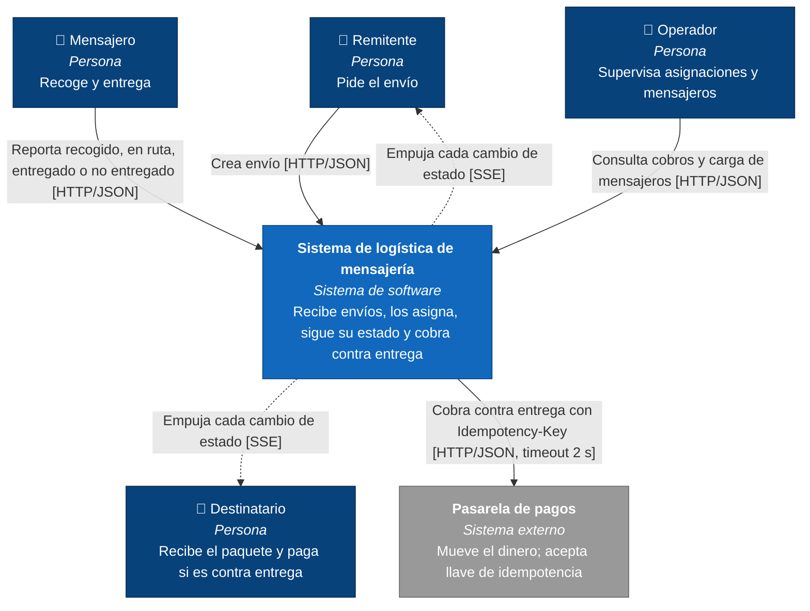
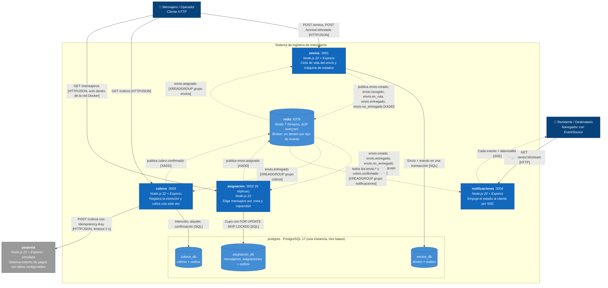

# 06 · Diagramas C4

> [NOMBRE 1], [NOMBRE 2], [NOMBRE 3] · [GRUPO 5A/5B]

Los nombres de las cajas del nivel 2 coinciden con los servicios de `docker-compose.yml`.

## Nivel 1 · Contexto

**Leyenda — nivel 1**

| Elemento                | Significado                                     |
| ----------------------- | ----------------------------------------------- |
| Caja azul oscuro con 👤 | Persona (tipo de usuario)                       |
| Caja azul               | El sistema que construimos                      |
| Caja gris               | Sistema externo que no controlamos              |
| Flecha continua `──▶`   | Petición síncrona iniciada por el origen (HTTP) |
| Flecha punteada `┄┄▶`   | Empuje asíncrono hacia el destino (SSE)         |
| Texto de la flecha      | Qué hace + `[medio / protocolo]`                |

## Nivel 2 · Contenedores

**Leyenda — nivel 2**

| Elemento                | Significado                                                                                                      |
| ----------------------- | ---------------------------------------------------------------------------------------------------------------- |
| Caja azul oscuro con 👤 | Persona / cliente                                                                                                |
| Caja azul               | Contenedor (proceso) del sistema: nombre del servicio en compose, puerto, tecnología y responsabilidad           |
| Cilindro azul claro     | Almacén de datos (broker o base de datos)                                                                        |
| Caja gris               | Sistema externo (aquí simulado por el servicio `pasarela`)                                                       |
| Recuadro "postgres"     | Una sola instancia de PostgreSQL con tres bases separadas; cada servicio usa solo la suya                        |
| Flecha continua `──▶`   | Llamada **síncrona**: HTTP o SQL, el origen espera la respuesta                                                  |
| Flecha punteada `┄┄▶`   | Comunicación **asíncrona**: evento publicado (`XADD`), evento consumido por un grupo (`XREADGROUP`) o empuje SSE |
| Texto de la flecha      | Mecanismo + nombre del evento o ruta                                                                             |

**Qué muestra el diagrama y vale la pena señalar en la defensa:**

- Entre `envios`, `asignacion`, `cobros` y `notificaciones` **no hay ninguna flecha continua**: solo eventos a través de `redis`.
- La única flecha continua que sale del sistema va de `cobros` a la `pasarela`.
- `notificaciones` no tiene base de datos ni publica eventos: nadie depende de ella.
